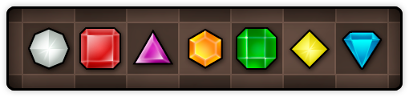
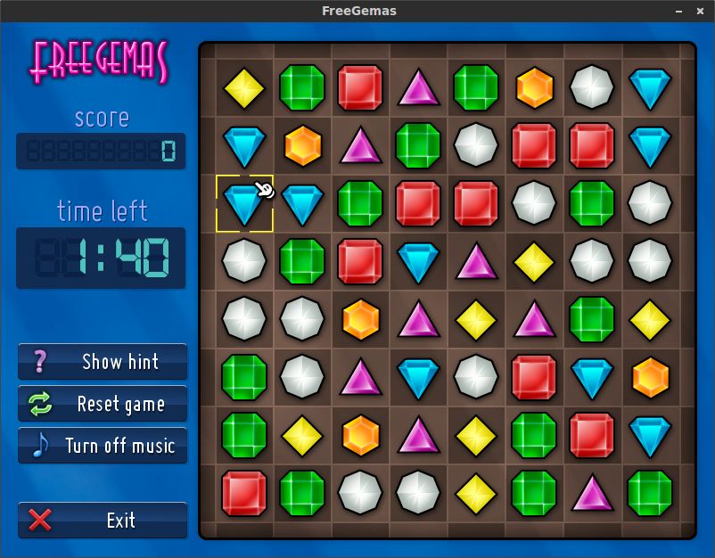
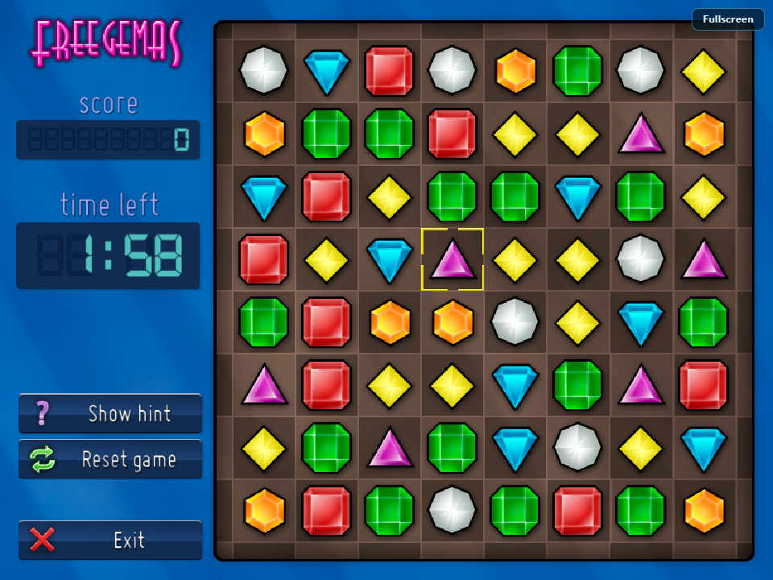

<p align="center">
    <br>
    <br>
</p>

__Freegemas__ is an open source version of the well known Bejeweled, for GNU/Linux, Windows, Mac and Playstation Vita. It's written in C++ using [SDL3](https://www.libsdl.org/). In the past it used Gosu instead of SDL3, and the old repository can be found at [Google Code](https://code.google.com/archive/p/freegemas/).

<p align="center">
    
</p>    
        


## Installation on Debian-based GNU/Linux systems

First, you need to install git and gcc:

    sudo apt-get install git build-essential cmake
    
After that, clone the repo:

    git clone --recursive https://github.com/JoseTomasTocino/freegemas.git
    
Do an out-of-source compilation and run the program:

    cd freegemas
    mkdir build
    cd build
    cmake ..
    make
    ./freegemas

## Installation on OS X

This assumes that you are already using [Homebrew](https://brew.sh/). You will need CMake and a few libraries to compile Freegemas:

    brew install cmake gettext

Now run the following commands to setup your environment to use Homebrew as a backup location for libraries.

```
[[ -z "${LIBRARY_PATH}" ]] && export LIBRARY_PATH=/usr/local/lib
export LIBRARY_PATH="$LIBRARY_PATH:$(brew --prefix)/lib"
```

After that, clone the repo:

    git clone --recursive https://github.com/JoseTomasTocino/freegemas.git
    
Do an out-of-source compilation and run the program:

    cd freegemas
    mkdir build
    cd build
    cmake ..
    make
    ./freegemas

## Installation on Playstation Vita

For building for Vita, the [Vita SDK](https://vitasdk.org) should be installed.

After that, clone the repo:

    git clone --recursive https://github.com/JoseTomasTocino/freegemas.git

Do an out-of-source compilation:

    cd freegemas
    mkdir vita
    cd vita
    cmake -DCMAKE_TOOLCHAIN_FILE="${VITASDK}/share/vita.toolchain.cmake" ..
    make

Now ``freegemas.vpk`` can be tranfered and installed on Vita.

## Running in the browser (WebAssembly)

The browser build requires [Emscripten](https://emscripten.org/) and CMake 3.28
or newer. Clone the repository with its submodules, then activate Emscripten:

    git clone --recursive https://github.com/JoseTomasTocino/freegemas.git
    source /path/to/emsdk/emsdk_env.sh

Build from the repository root with the helper script:

    ./platform/wasm/build.sh

On Windows:

    .\platform\wasm\build.ps1

The helper scripts also pick up `EMSDK` automatically when it is set. The output
is written to `build-wasm/` and the entry point is `build-wasm/freegemas.html`.

The build is a static site and can be hosted on GitHub Pages or any other web
server. To test it locally, serve the output directory over HTTP:

    python3 -m http.server 8000 --directory build-wasm

Then open <http://localhost:8000/freegemas.html>. Opening the HTML file directly
from disk does not work because browsers block the runtime's file fetches. Click
**Play** once to enable browser audio.



## Music licensing

The music in the game is [Easy Lemon by Kevin MacLeod](https://incompetech.com/music/royalty-free/index.html?isrc=USUAN1200076)
Licensed under [Creative Commons: By Attribution 3.0](https://creativecommons.org/licenses/by/3.0/)
