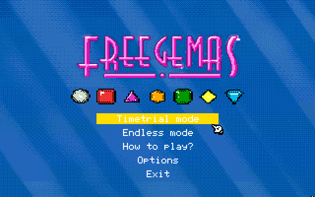
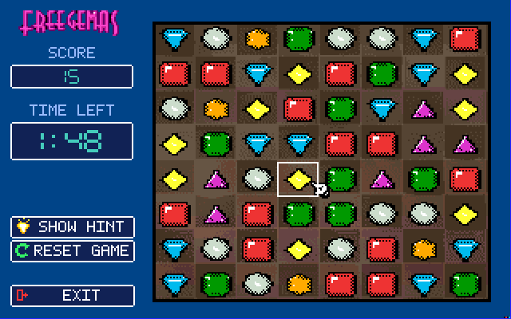

# Freegemas for Apple IIGS

English | [繁體中文](README-tw.md)

<p align="center">
  
  
</p>

An Apple IIGS port of Freegemas, written in 65816 assembly using Merlin32 and targeting GS/OS (S16 executable). Graphics utilize 320×200 Super Hi-Res (4bpp) with per-scanline 16-color palettes. The gameplay board features 8 columns with symmetric 2px borders, source-aligned wood texture, and authentic 2D square pixel-art gems. Audio uses the Ensoniq 5503 DOC chip for streamed music and native sound effects.

The build produces a bootable 2MG disk image at `merlin32/build/freegemas.2mg`; the image is not tracked.

## Requirements and build

### Prerequisites
- [Merlin32](http://www.brutaldeluxe.fr/products/crossdevtools/merlin/) 1.2 beta 2 or later (not included; pass its path as `MERLIN32`)
- Python 3 with [Pillow](https://python-pillow.org/)
- `ffmpeg` (for DOC audio conversion from original `media/*.ogg`)
- Cadius 1.4.5 (not included; pass its path as `CADIUS`)
- A GS/OS base template disk you are licensed to use (not included; put it at
  `iigs/build/gsos-template.2mg` or pass `TEMPLATE`)

### Build instructions

From the repository root:

```powershell
# 1. Generate SHR scenes, palettes, and compiled gem blitters
python iigs/tools/build_iigs_assets.py

# 2. Create the build directory and generate DOC PCM waves/music
python -c "from pathlib import Path; Path('iigs/merlin32/build').mkdir(parents=True, exist_ok=True)"
python iigs/tools/build_iigs_sounds.py iigs/merlin32/build

# 3. Assemble and pack the 2MG bootable disk
cd iigs/merlin32
make disk MERLIN32=C:\path\to\Merlin32.exe CADIUS=C:\path\to\cadius.exe `
  TEMPLATE=C:\path\to\gsos-template.2mg
```

`make disk` compiles `FREEGEM.S16`, stages assets, updates `/SYSTEM/SetStart.data` to auto-boot `FREEGEM.S16`, and creates the bootable `build/freegemas.2mg` image via Cadius.

## Hardware requirements

- Apple IIGS (ROM 01 or ROM 03) or a compatible emulator (GSSquared, GSplus, KEGS, Sweet16).
- **RAM: 2 MB total is the recommended minimum; 4 MB or more is preferred.**
  - The 1,413,400-byte BGM soundtrack (~1.35 MiB) is cached into a locked RAM handle at startup for stutter-free playback.
  - If memory is insufficient to cache the full song, the engine automatically falls back to background streaming from disk via GS/OS.

## Controls

- **Title Screen**: W/S or Up/Down arrow keys move selection; Space or Enter opens an item. Mouse hover and clicking are fully supported.
- **How to Play**: Press any key or click to return to the title screen.
- **Options**: Up/Down arrow keys or mouse select options; Space/Enter or click toggles Music and Sound; Esc returns to title.
- **Game**:
  - **Keyboard**: W/A/S/D or arrow keys move the cell selector; Space selects and swaps gems.
  - **Mouse**: Click two adjacent gems, or hold and drag a gem to an adjacent cell to attempt a swap.
  - `H`: Show Hint (highlights a legal move; next scoring match awards no points).
  - `R`: Restart the current mode.
  - `Esc`: Return to the title screen.
  - Left HUD buttons (`Show Hint`, `Reset Game`, `Exit`) can also be clicked directly.

## Gameplay and graphics

- **Game Modes**:
  - **Time Trial**: Race against a 120-second timer. Cascades already underway complete when time runs out before Game Over triggers.
  - **Endless**: Play without a timer. The game ends when no legal moves remain on the board.
- **Board Layout**:
  - Full 8 columns $\times$ 8 rows ($26\text{ px} \times 22\text{ px}$ per cell).
  - The board width is $212\text{ px}$ ($x = 96 \sim 307$) with 2px symmetric black borders.
  - Outer screen margins on both the left ($x = 84 \sim 95$) and right ($x = 308 \sim 319$) are exactly $12\text{ px}$ of deep blue background, ensuring perfect horizontal centering.
- **Visuals**:
  - Hand-crafted 24×20 2D square gem pixel art preserved without algorithmic distortion.
  - Restorations after gem moves use damage-rectangle blitters restoring directly from cached background RAM (`dTitleSave`).
  - Title, How to Play, and Options screens use a 12-bank palette sampling with 4×4 Bayer ordered dithering over blue light rays.
- **High Scores**:
  - High scores for Time Trial and Endless modes are persistently saved to `HISCORE.DAT` in the `/FREEGEMAS/DATA` folder.

## Audio architecture

- **Sound Effects**: Original sound clips (`select.ogg`, `fall.ogg`, `match1..3.ogg`) converted to Ensoniq DOC 8-bit unsigned PCM. Played through dedicated DOC oscillator pairs (0/1 for Select, 2/3 for Fall, 4/5 for Match).
- **Background Music**: Complete ~126-second stereo-to-mono soundtrack converted to DOC format (11,186 Hz). Played via oscillator pair 6/7 using double-buffered 4 KiB wave tables synchronized to DOC end interrupts.

## Project layout

- `iigs/merlin32/src/main.s`: Main 65816 game engine, blitters, input, HUD, audio, and GS/OS interface.
- `iigs/merlin32/generated/`: checked-in build inputs (gem data and scene binaries).
- `iigs/merlin32/Makefile`: Assembly and disk packaging targets. Set `MERLIN32`, `CADIUS`, and `TEMPLATE` for your local tools.
- `iigs/tools/build_iigs_assets.py`: SHR asset conversion script (scenes, palettes, blitters).
- `iigs/tools/committed_art.py`: Board layout, palette assignment, and scene generator.
- `iigs/tools/hud_art.py`: Left sidebar HUD and digit mask generators.
- `iigs/tools/build_iigs_sounds.py`: DOC PCM and BGM track converter.
- `iigs/tools/pack_disk.py`: ProDOS/GS/OS 2MG disk image packager.
- `iigs/build/` and `iigs/merlin32/build/`: ignored output directories; local tool/template files also go there or on `PATH`.
