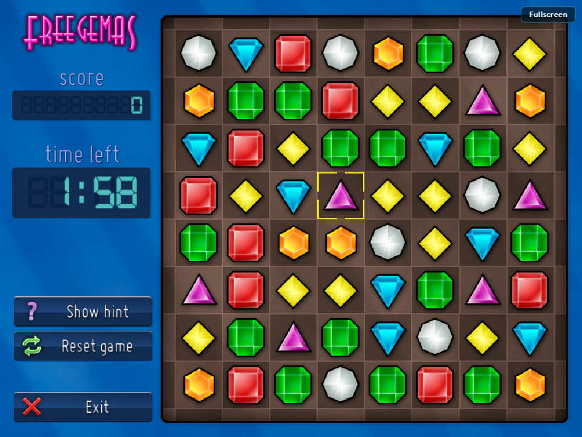

# Freegemas WebAssembly

Browser build of Freegemas, built with Emscripten and SDL3.

The port keeps the original game media and gameplay. It only adds a browser
entry point, a custom HTML shell, and an Emscripten-specific main loop.



## Status

- Builds and runs in a browser via Emscripten.
- Boots to the title screen; Time Trial starts with mouse or keyboard input.
- Music and sound run through SDL3_mixer; the audio context starts after the
  first user gesture.
- Options, high scores, and other `options.json` data are persisted through
  Emscripten IDBFS and survive page reloads.
- Exiting from the menu shows a restart screen instead of leaving a frozen
  canvas.
- Fullscreen button is available in the top-right corner.
- Validated locally with Emscripten 7.0.0 and headless Chrome on Windows.

## Prerequisites

- [Emscripten SDK](https://emscripten.org/docs/getting_started/downloads.html)
  with `emcc`/`emcmake` active.
- CMake 3.28 or newer.
- Ninja is recommended.
- The vendor submodules (SDL3, SDL3_mixer, SDL3_ttf, jsoncpp) must be present.

Activate Emscripten before building:

```powershell
# Windows PowerShell
& C:\dev\emsdk\emsdk_env.ps1
```

```bash
# Linux / macOS
source /path/to/emsdk/emsdk_env.sh
```

## Build

Windows:

```powershell
# from the repository root
.\wasm\build.ps1

# or choose the SDK explicitly
.\wasm\build.ps1 -Emsdk C:\dev\emsdk
```

Linux / macOS:

```bash
./wasm/build.sh
```

The output directory defaults to `build-wasm/` at the repository root. The
entry point is `build-wasm/freegemas.html`.

## Run

A local HTTP server is required because the Emscripten runtime loads the
WebAssembly module and the preloaded media data over HTTP:

```powershell
python -m http.server 8000 --directory build-wasm
```

Then open <http://127.0.0.1:8000/freegemas.html>. Click **Play** once to enable
browser audio; the generated canvas is responsive and letterboxed to the game's
4:3 aspect ratio.

## Controls

The game's original controls apply:

- Mouse: click a gem, then click an adjacent gem to swap.
- Keyboard: arrow keys to navigate menus, Enter/Space to select, Escape to go
  back.
- Gamepad: supported through SDL3's browser gamepad backend.

## Implementation notes

- `src/go_window.cpp` refactors the game loop into `tick()` and uses
  `emscripten_set_main_loop_arg()` for browser builds. Native builds keep the
  original blocking `while` loop and frame pacing.
- `wasm/shell.html` provides the page layout, responsive canvas, loading
  screen, click-to-start audio unlock, and fullscreen control.
- The root `CMakeLists.txt` gains an `EMSCRIPTEN` branch. Media is embedded with
  `--preload-file <repo>/media@/media`, so no separate media server is needed.
- Options and high scores use SDL's Emscripten preference path under `/libsdl`,
  which is backed by IDBFS. The shell mounts IDBFS before the game starts and
  synchronizes it periodically and on unload.

## Validation

Basic checks performed locally:

- CMake configure and link with Emscripten.
- Page loads; title screen renders at 960x720 and scales responsively.
- Keyboard and mouse navigation reach the Time Trial game.
- Audio context reaches `running` after the Play gesture.
- Options can be changed; `/libsdl/freegemas/options.json` is written and the
  value survives a page reload.

No real-hardware or mobile-touch validation has been done for this browser
build.

## License

Freegemas is distributed under GPLv2; see `LICENSE`. The browser build includes
the project media and the third-party libraries listed in
`THIRD-PARTY-LICENSES.md`.
